# 星辉双层旋转木马 · 星梦奇境 ASTRALIA

一座可以在浏览器里自由漫步、参观并乘坐的 3D 复古游乐场。乐园中央是原创的 **星辉双层旋转木马（The Starlight Carousel · 1908）**：上下两层鎏金穹顶、手绘帷幔、镜面中柱、二十八匹手工飞马、三辆马车、两座旋转楼梯，以及一段实时合成的八音盒圆舞曲。

气质上参考经典主题乐园的黄金年代，但不包含迪士尼、环球影城的角色、标识或受版权保护的素材。

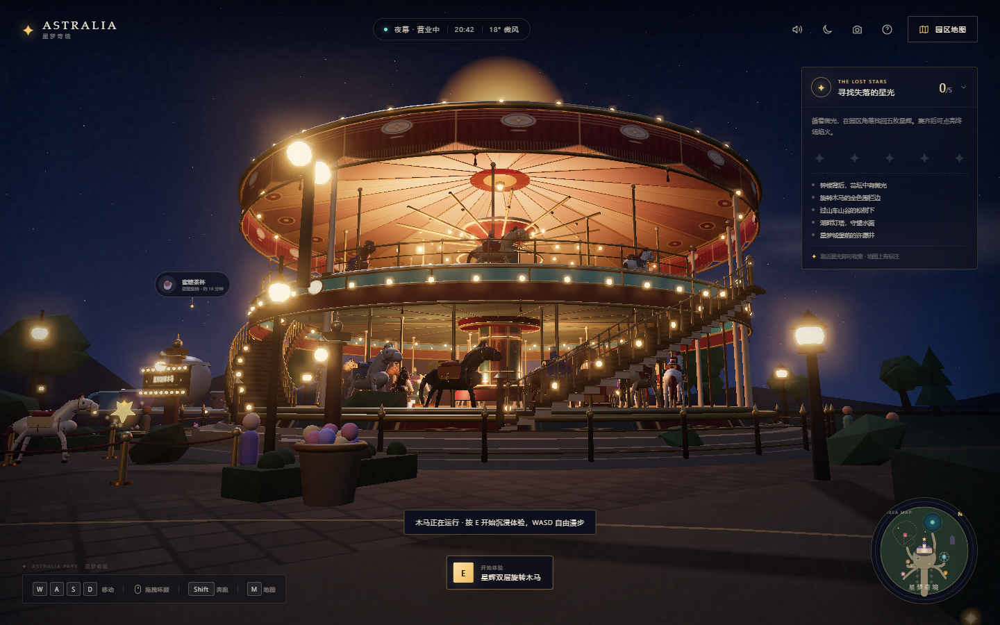

[开场](preview/intro.png) · [乘坐机位](preview/ride.png) · [空中缆车](preview/skyway.png) · [云上星穹](preview/balloon-explore.png) · [彩虹滑道](preview/rainbow-park.png)

## 新设施 · 黑帆湾 · 海盗船

星海湖的旧帆船航线已经换上 **黑帆号**。这不再是岸边观看的水上演出：登船后可以自己调摆幅，亲手把船荡到最高点，拖动画面环绕整艘鎏金骨雕海盗船；也可以随时回到星梦奇境继续游园。

**在园中：** 前往星海湖，靠近黑帆号后按 `E` / 点击「开始沉浸体验」  
**直接进入：** <http://127.0.0.1:4173/?pirate=1>  
**独立页面：** <http://127.0.0.1:4173/pirate/>

[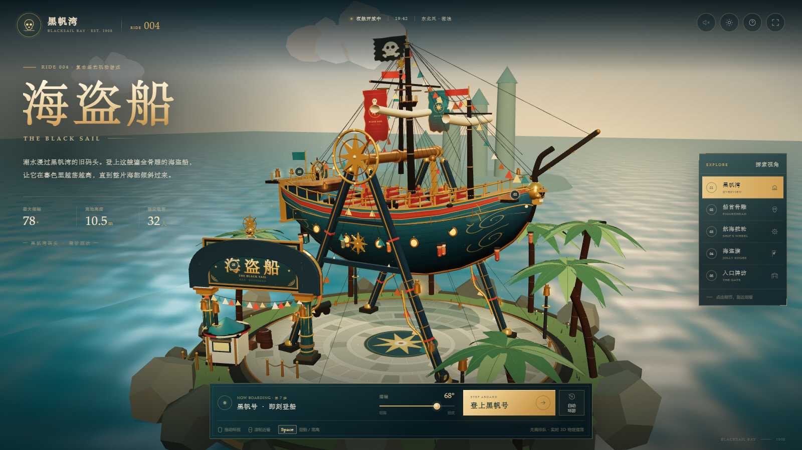](http://127.0.0.1:4173/?pirate=1)

从星梦奇境内部进入时，会保留一条窄窄的 ASTRALIA 返回栏：

[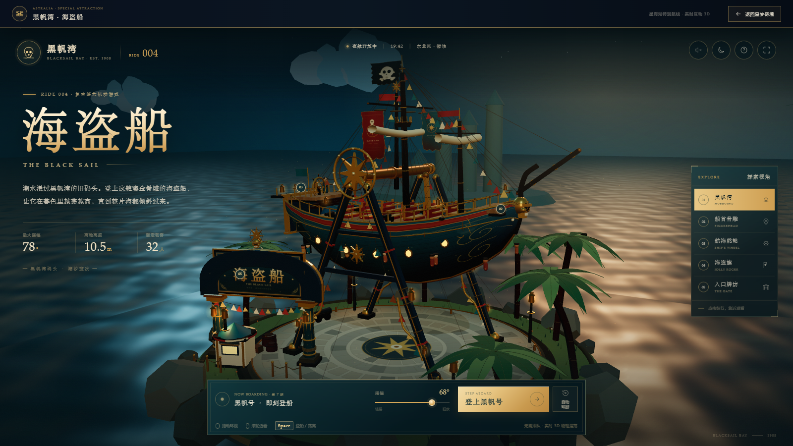](http://127.0.0.1:4173/?pirate=1)

- 完整 3D 岛屿、海盗船、A 字支架、入口牌坊、棕榈、海水与夜航灯光；
- 摆幅 30°–78° 可调，航行中可加力、环绕、滚轮拉近；
- 支持暮色 / 夜航、实时合成海浪 / 风 / 木桅 / 海鸥 / 汽笛；
- 从星梦奇境进入时会自带「返回星梦奇境」栏，原有游园动线不受影响。

## 新设施 · 瓷梦茶会

东庭的旋转茶杯已经整体升级为「瓷梦茶会」：奶油瓷、孔雀蓝与鎏金，中央是会吐雾的青花巨壶，八只描金瓷杯各有纹样。

**在乐园中体验：** 前往东庭「瓷梦茶会」，按 `E` / 点击「进入茶杯 · 亲手操控」，直接坐进杯内；  
**独立入口：** <http://127.0.0.1:4173/teacup/>

[](http://127.0.0.1:4173/teacup/)

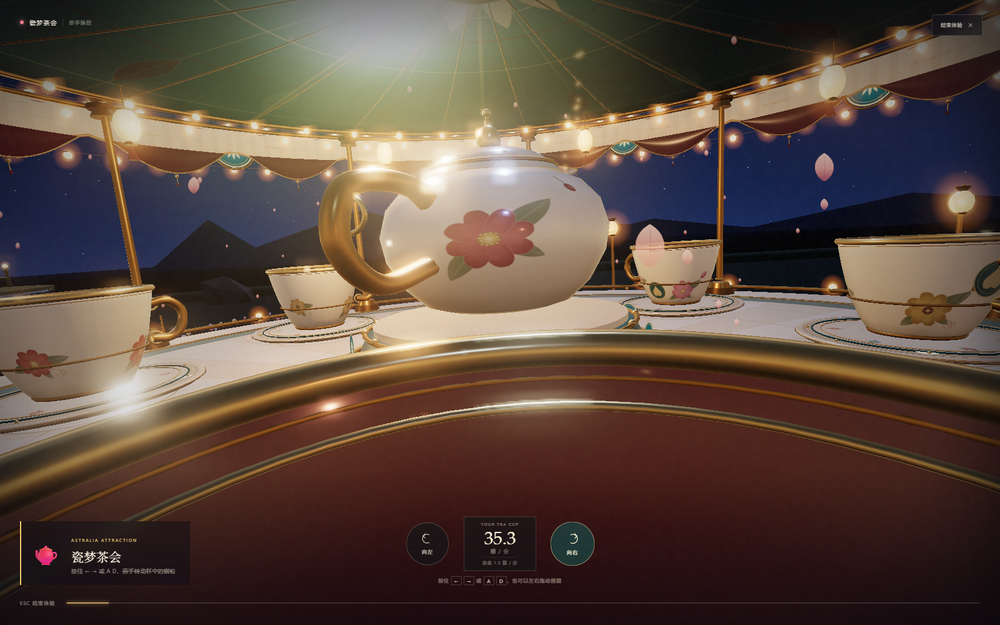

[乐园中的外观](preview/teacup-park.png)

- 可自由环顾、点击选杯、登杯乘坐；
- 杯内视角按住 `←` `→` / `A` `D` 或左右拖动画面，亲手转动茶杯；
- 支持黄昏 / 夜幕、环境合成音乐、全屏与移动端；
- 实时 3D，不是视频，也不依赖外部素材。

## 新设施 · 星梦空中缆车

一条真正横跨全园的高空索道已经开通。从星光大道西侧的 **星港站** 登上一只宝石色吊厢，掠过树梢与广场，越过城堡西翼，在离地二十多米的夜色里滑向 **湖畔站**。全程双索道循环运行，八只描金吊厢始终在空中缓缓巡游。

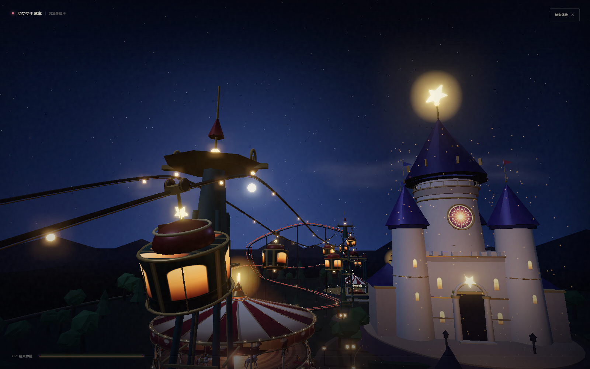

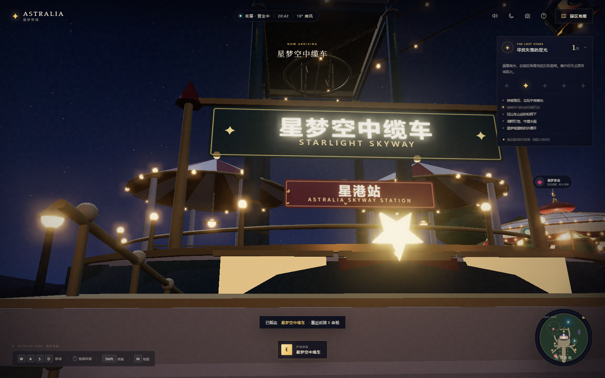

**在园中：** 从地图点击「星梦空中缆车」前往星港站，靠近站房后按 `E` / 点击「开始沉浸体验」  
**沿途：** 星港站 → 云杉塔 → 星梦广场西侧 → 镜湖塔 → 湖畔站

- 两座维多利亚式缆车站：奶油色立柱、绯红条纹帐篷、鎏金穹顶与暖灯；
- 双索道、两座装饰塔架与实时摆动的吊厢；
- 23 秒高空乘坐镜头，可俯瞰城堡、旋转木马、摩天轮与星海湖；
- 地图上新增完整索道线路与两座终点站标记。

## 新设施 · 彩虹滑道机

南庭的鎏金穹顶下，六条琉璃滑道从十八米高的塔顶倾泻而下。绯红、琥珀、鎏金、翡翠、湖蓝、紫晶——挑一条颜色，沿着双侧鎏金阶梯登顶，在风、铃声与十四枚虹光星屑里滑进夏天。

**在园中：** 地图前往「彩虹滑道机」，靠近南庭滑道后按 `E` / 点击「开始沉浸体验」  
**直接进入：** <http://127.0.0.1:4173/?rainbow=1>  
**独立页面：** <http://127.0.0.1:4173/rainbow/>

[](http://127.0.0.1:4173/rainbow/)

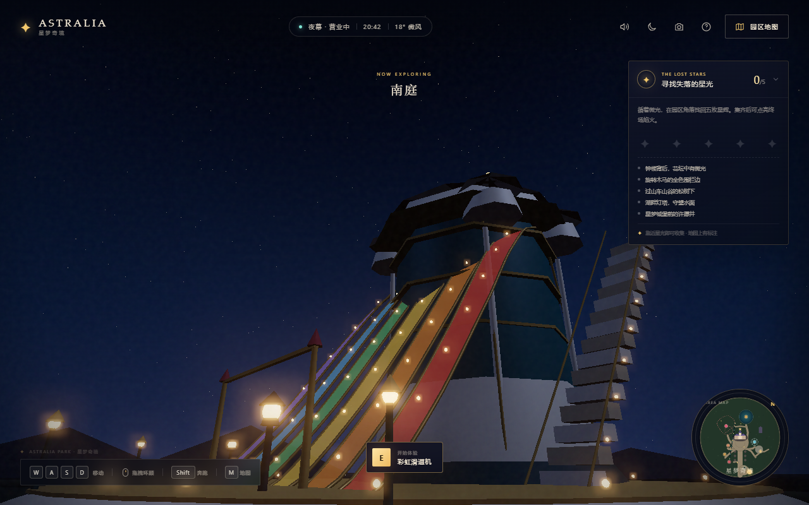

- 六条滑道可自由选择，点击滑道、色点或左右箭头即可换色；
- 乘坐镜头会带你走上右侧鎏金阶梯，在塔顶倒计时后滑下；
- 滑行中按住 `W` / `↑` / 鼠标左键加速，`A D` 左右微调去收集虹光星屑；
- 支持暮色 / 晴日 / 夜幕、声音、全屏与移动端，全部为实时 3D 与程序化材质。

从星梦奇境进入时，滑道会装在带「返回星梦奇境」栏的联动舞台里：

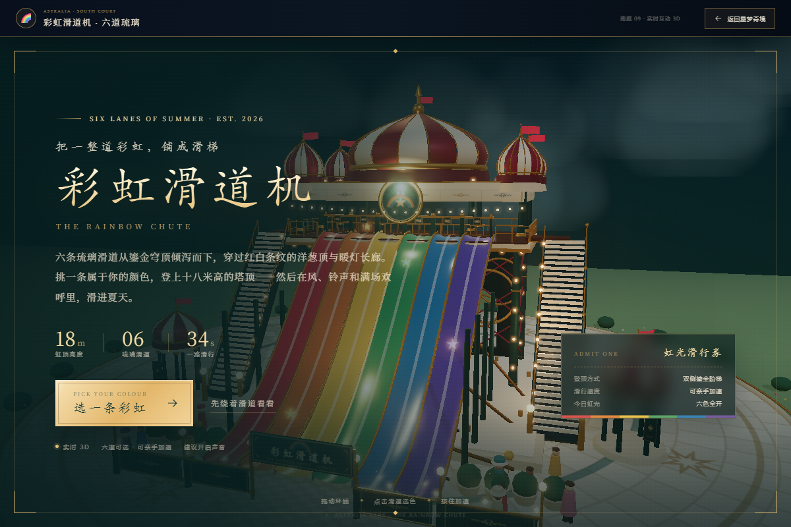

## 新设施 · 云上星穹

云端区新落成一座 **72 米高的热气球升降塔**。八朵云舟各自升降，不一起升空，也不一起落下；登舟后可以亲手升空、悬停、缓降，也可以交给一条 58 秒的暮色航线。

**在园中：** 地图前往云端区「云上星穹」，靠近星冠后按 `E` / 点击「开始沉浸体验」  
**直接进入：** <http://127.0.0.1:4173/?balloon=1>  
**独立页面：** <http://127.0.0.1:4173/balloon/>

[](http://127.0.0.1:4173/balloon/)

- 八朵热气球独立升降，实时高度面板展示“有升有降”的云海；
- 跟随镜头 / 吊篮第一人称双镜头，`V` 切换；
- 按住 `↑` / `空格` 升空，松手像降落伞一样缓降；`A` 自动巡游；
- 暮色 / 夜幕 / 晴日三种天光，程序化星冠、球囊、木篮与云海；
- 实时合成音乐盒圆舞曲、风噪与燃烧器声。

[乘坐镜头](preview/balloon-ride.png) · [夜幕](preview/balloon-night.png) · [移动端](preview/balloon-mobile.png)

## 新设施 · 东庭双馆与星灯庭

东庭新增 **复古飞椅** 与 **迷你飞行器**：前者由十六把宝石色吊椅、金色链条和红白条纹穹顶组成；顶棚由中央塔身悬挑，外围不再设置落地立柱。待机时吊椅落在平台地面，启动后先收索升空，再加速旋转并向外摆开。后者围绕带四面时钟、金色齿轮和羽翼的控制塔飞行，六架双翼机机头朝向旋转切线，带起落架、翼间张线、奶油色圆徽与金色螺旋桨，升空后可独立升降。

星灯庭新增 **复古碰碰车**：红白条纹帐篷、深色棋盘格场地和七辆圆润的电动碰碰车。进入后可自由驾驶、转向、碰撞，每次碰撞都会亮起一圈金色星屑。

**在园中：** 从南庭沿东庭环线步行，或在地图点击「复古飞椅 / 迷你飞行器 / 复古碰碰车」传送；靠近后按 `E` / 点击「开始沉浸体验」。  
**互动：** 飞椅为自动旋转飞行；迷你飞行器用 `W / S` 控制升降；碰碰车用 `W / S` 前进后退、`A / D` 转向；手机端显示虚拟摇杆。  
**地图：** 南庭西侧支路直达星灯庭，南庭东侧环线串联东庭双馆；地图上的设施名称和圆点都可以点击。

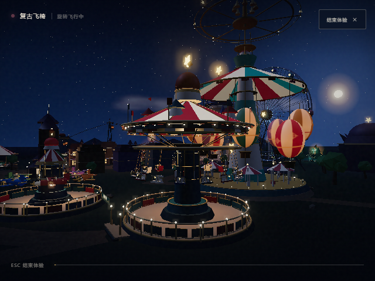

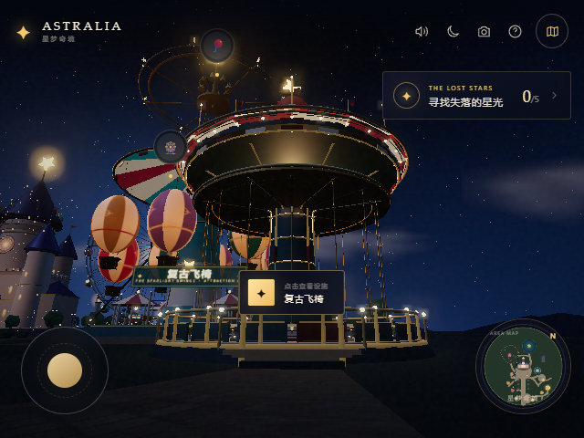

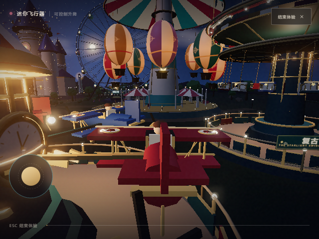

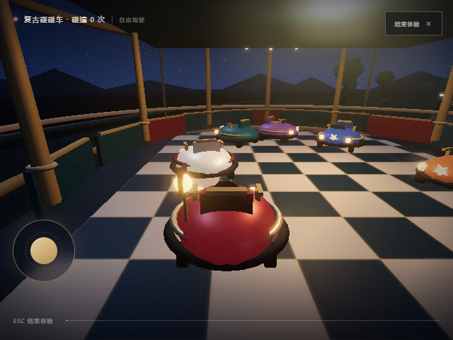

## 新设施 · 急流泛舟

松泉谷新增 **急流泛舟**：环形水道绕着一座布满松林与苔藓的岩山，三道瀑布从洞穴与岩壁落入水中；金色栏杆、深青围栏、石拱桥与四座红白条纹凉亭围出完整的探险河谷。四艘红、蓝、绿、金色圆形浮筏各有六个独立座位、扶手与安全压杆，沿闭合水道漂行并轻微旋转，经过急流岩石、瀑布与水花区时持续起伏。

**在园中：** 从星光大道西侧沿新步道经过空中缆车站，继续步行到松泉谷；或在地图点击「急流泛舟」传送。靠近入口按 `E` / 点击「开始沉浸体验」。

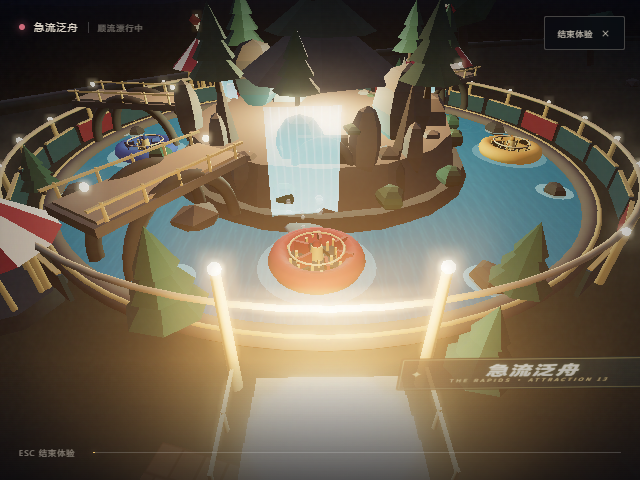

## 新设施 · 水上碰碰船

星港水坞新增 **水上碰碰船**：奶油白石栏杆与金色灯柱围着一座圆形水池，南侧是红白条纹的港口游乐场凉亭，中央穹顶、侧塔、铁锚纹章与红色小旗组成完整的复古海港门面。五艘蒸汽船、小帆船和圆艇共用一套船体比例，配有座椅、方向盘、金色扶手和黑色防撞边缘；它们可以独立前进、后退、转向，轻轻碰撞时会反弹并荡开水面波纹。

池中漂浮着 5 枚金色星标。驾驶时用 `W / S` 前进后退、`A / D` 转向，手机端使用虚拟摇杆；收集全部星标即可完成一次巡航。

**在园中：** 从星海湖西岸沿新步道步行到星港水坞；或在地图点击「水上碰碰船」传送。靠近入口按 `E` / 点击「开始沉浸体验」。

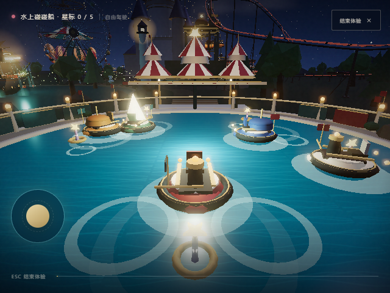

## 新设施 · 环园复古小火车

**环园复古小火车** 沿岛缘窄轨环线运行，设南门、东庭、星海、松泉四座维多利亚车站。酒红、深青绿与古典金涂装的蒸汽机车拖着三节客车，带圆形车灯、烟囱、锅炉外壳、金色铭牌、车轮、车轴与连接钩；车站有红白条纹顶棚、金色站牌、复古时钟、木质长椅、灯笼与栏杆。

列车逐站停靠。到站停稳后按 `E` 下车，步行进入对应园区；在站台靠近时按 `E` 或点击提示上车。地图上绘制了环线和四座车站，点击车站可直接抵达站台。

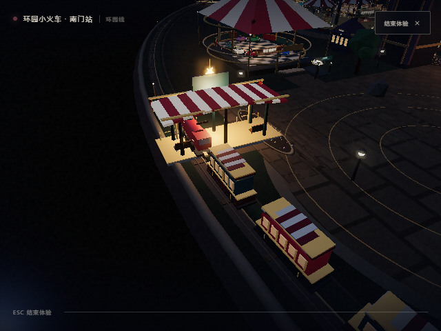

## 新增小设施

主街两侧新增七座与全园统一的复古服务设施，全部为精细 3D 静态模型，无动画：

- **棉花糖贩卖亭**：红白条纹穹顶、棉花糖机、粉蓝棉花糖袋与金色绳栏；
- **汽水小食贩卖亭**：SODA / POPCORN / SNACK 菜单、饮料瓶、爆米花机、纸杯与柜台；
- **小丑气球摊位**：小丑头像、气球招牌，以及小狗、宝剑、花朵、星星、皇冠、兔子等不同形态的扭气球；
- **厕所**：奶油石基座、LADIES / GENTS 双门、红蓝标识、花箱与金色灯柱；
- **热狗摊**：屋顶巨型热狗、保温柜、面包与酱料；
- **汉堡摊**：屋顶巨型汉堡、芝士/肉饼/生菜细节、菜单牌与薯条；
- **公园餐厅**：两层红白穹顶、深青与古金拱窗、PARK RESTAURANT 站牌、条纹遮阳篷、露台餐桌与红白阳伞。

地图上也增加了七个小设施图标。

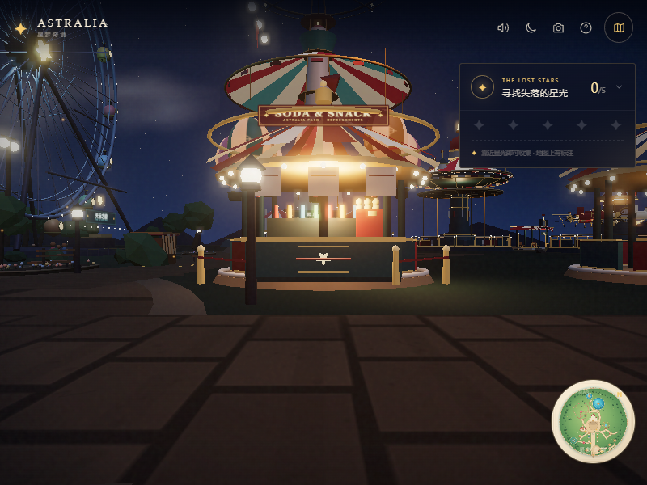

## 园区地图

地图已重绘为奶油纸张与手绘森林风格，按当前园区的实际坐标绘制步道、水系、中央城堡、摩天轮、旋转木马、过山车、各主题设施、环园铁路与四座车站。14 个项目和 4 座车站都可以直接点击：点击地标会前往设施并打开体验面板；点击车站会抵达站台，再按 `E` 上车。

按 `M` 或点击小地图打开。地图支持 PC 与触屏，缩放后的标签仍保留点击热区。

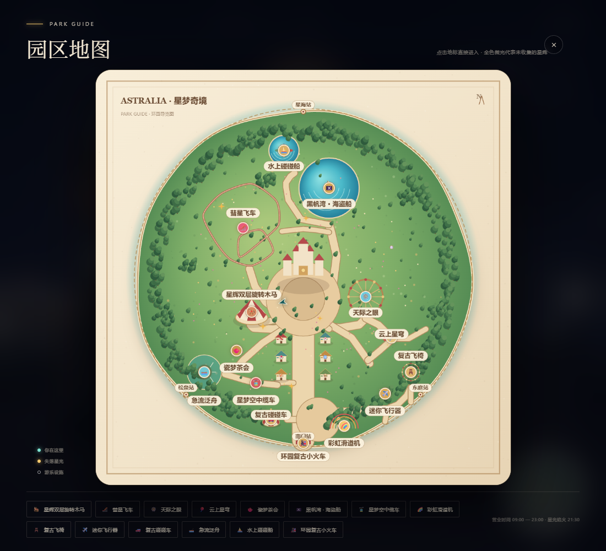

## 现在进入

**http://127.0.0.1:4173**

服务已启动。如果之后需要重新启动，在项目目录运行：

```bash
node scripts/server.mjs
```

也可以直接双击根目录的 `start-park.cmd`。不需要 `npm install`、不需要构建，不依赖 CDN 或外部图片/音频资源。

## 主角：星辉双层旋转木马

进入乐园后会直接站在木马前，不用先穿过整座园区：

- 按 `E` 或点击设施提示，进入 12 秒的沉浸式双层环绕演出；
- 木马会加速旋转，上层与下层的穹顶灯泡、彩绘帆布、镜面中柱和两座螺旋楼梯依次展开，同时响起实时合成的游乐场风琴圆舞曲；
- 演出可以随时按 `Esc` 或右上「结束体验」退出；
- 其他十三座设施：彗星飞车、天际之眼、云上星穹、瓷梦茶会、黑帆湾·海盗船、星梦空中缆车、彩虹滑道机、复古飞椅、迷你飞行器、复古碰碰车、急流泛舟、水上碰碰船、环园复古小火车，也都可以乘坐；
- 桌面端使用 `W A S D` + 鼠标，移动端使用摇杆与拖拽。

## 可以玩什么

- **扩建园区**：岛屿半径由 128 扩展到 160，向南新增「南庭」与「星灯庭」，向东新增「东庭」，云端区继续向东扩展；主街、南庭和东庭之间形成一个完整的步行环线。
- **自由漫步**：第一人称游览星光大道、星梦广场、松林山谷、扩大的云端区、星海湖畔、南庭、东庭、星灯庭、松泉谷、星港水坞与四座环园火车站。
- **十四项可乘坐设施**：每项都有独立镜头与实时动画；除双层木马与空中缆车外，复古飞椅、迷你飞行器、复古碰碰车与水上碰碰船也可亲手互动，急流泛舟随圆筏漂流，环园小火车则逐站停靠。
- **失落星光收集**：在园区角落寻找 5 枚星辉碎片，集齐后点亮城堡上空的终场焰火，并获得「星光守夜人」徽章。
- **实时夜景**：双层旋转木马、摩天轮、过山车列车、茶杯、空中缆车吊厢、云上星穹的八朵云舟、彩虹滑道的滑行座舱、复古飞椅的吊椅、迷你飞行器的螺旋桨、碰碰车、急流泛舟的圆筏与瀑布、水上碰碰船与金色星标、环园小火车与车轮、巡游花车和湖上帆船全部实时运动。
- **日夜与暮色**：右上角可在夜幕、暮色、晴日之间切换，灯光、天空、雾和焰火会随之变化；木马在日光下会呈现另一种彩绘质感。
- **游园工具**：点击地标传送的园区地图、小地图、项目详情、排队提示、明信片拍照（自动下载 PNG）。
- **移动端适配**：触屏摇杆移动，拖动屏幕环顾，项目详情以底部抽屉打开。

## 操作

| 操作 | 桌面 | 手机 |
| --- | --- | --- |
| 移动 | `W A S D` / 方向键 | 左下摇杆 |
| 环顾 | 按住鼠标拖动画面 | 拖动画面 |
| 奔跑 | `Shift` | — |
| 体验附近项目 | `E` 或点击项目提示 | 点击项目提示 |
| 园区地图 | `M` | 右下地图 |
| 拍照明信片 | `P` | 相机按钮 |
| 帮助 | `H` | 问号按钮 |
| 结束乘坐 / 关闭弹层 | `Esc` | 右上关闭按钮 |

## 场景与声音

背景音乐、钟声、木马风琴、过山车风声、星光收集音效和焰火声全部由 Web Audio 实时合成，没有音频文件。建议佩戴耳机；右上角可以随时静音。

木马音乐是一段循环的 3/4 拍游乐场风琴曲，使用三角波、正弦波、低通滤波和短混响合成；它只在乘坐木马时响起，退出后自动淡出。

## 技术说明

- Three.js r180，作为本地 vendor 模块随项目提供；原生 ES Modules + import map，不需要打包器。
- 全程序化建模与 Canvas 材质：天空、牌匾、木马彩绘、穹顶、帷幔、镜面中柱、湖面与水面光环均无外部素材。
- 发光灯泡使用 InstancedMesh；木马与静态装饰分别按材质合并，静态部件只保留少量 draw call。
- 木马具备上下两层独立起伏、轻微倾摆、加速旋转、顶星旋转、旋转楼梯与游客骑乘动画。
- 本地进度记忆：星光收集与终章状态会保存在浏览器 `localStorage` 中。
- `preview/` 内保留了开场、木马、乘坐机位和星空全景四张实时截图。

## 目录

```
index.html                入口、UI 结构与 import map
src/main.js               相机、控制器、游园交互、乘坐镜头
src/carousel.js           共享木马、马车、帷幔与贴图构件
src/double-carousel.js    1908 星辉双层旋转木马：双层结构、旋转楼梯、动画
src/world.js              园区、城堡、道路、灯光、游客、合并优化
src/rides.js              其他游乐设施与星海湖
src/skyway.js             星梦空中缆车：双索道、吊厢与乘坐镜头
src/designs.js            云上星穹 / 彩虹滑道机的园区实体模型
src/swing.js              复古飞椅：塔身、顶盘、吊椅与离心动画
src/planes.js             迷你飞行器：控制塔、飞机与螺旋桨动画
src/bumper.js             复古碰碰车：展馆、车辆与碰撞互动
src/rapids.js             急流泛舟：环形水道、瀑布、圆筏与漂流动画
src/boats.js              水上碰碰船：水池、港口凉亭、船只与收集玩法
src/train.js              环园复古小火车：环线、四站、机车与客车
src/facilities.js         七座主街小设施：餐饮亭、气球摊、厕所与餐厅
src/effects.js            天空、星野、焰火、魔法尘
src/audio.js              Web Audio 合成声景与木马风琴曲
src/data.js               项目、星光、区域与色彩配置
src/style.css             界面样式与响应式布局
balloon/                  云上星穹：热气球升降塔（独立入口）
rainbow/                  彩虹滑道机（独立入口）
scripts/server.mjs        极简静态服务器
vendor/three/             本地 Three.js 与 addons（MIT）
preview/                  预览截图
```

---

*星梦奇境是一座虚构乐园，献给每一个还愿意在夜里抬头看星星的人。*
