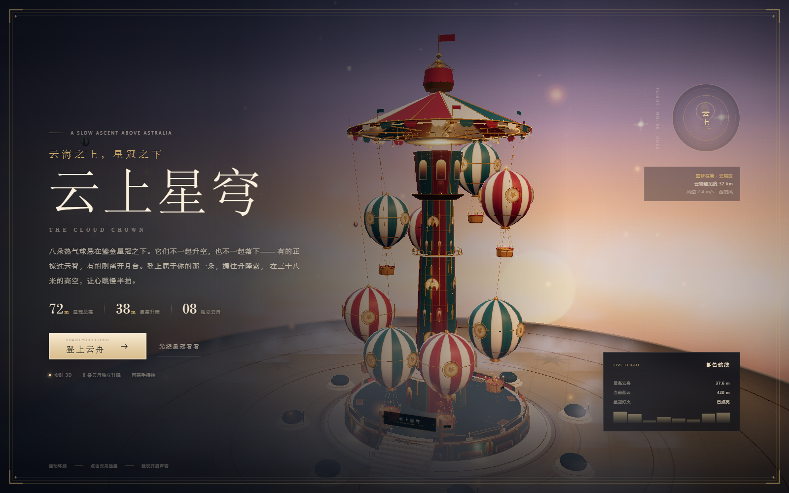

# 云上星穹 · THE CLOUD CROWN

一座可以亲手升降、乘坐的实时 3D 梦幻热气球机动设施。参考图中的奶油纸色、酒红帷幔、孔雀青与鎏金细节，被重新组织成一座 **72 米高的星冠升降塔**：八朵热气球沿着各自的航线独立上升、悬停与缓降，不一起升空，也不一起落下。

**入口：** <http://127.0.0.1:4173/balloon/>



[自由环顾](../preview/balloon-explore.png) · [跟随镜头乘舟](../preview/balloon-ride.png) · [夜幕](../preview/balloon-night.png) · [移动端](../preview/balloon-mobile.png)

## 可以怎么玩

- **八朵独立云舟**：每朵热气球都有自己的升降曲线、悬停时长与缓降节奏；面板实时显示八条高度。不是同步升降，而是“云海里各有各的潮汐”。
- **两套乘坐镜头**：登舟后默认是 **跟随镜头**，能看见自己的球囊、吊篮、星冠与邻舟；按 `V` 或点右上镜头按钮，可切到 **吊篮第一人称**，从篮沿上方俯瞰云海。
- **亲手升降**：按住 `↑` / `空格` 升空，按住 `↓` / `S` 缓降；松手后球囊会像降落伞一样缓慢回落。按住下降时会有更明显的失重下滑，但最高速度仍是慢速跳楼机的尺度。
- **自动巡游**：按 `A` 或点「自动巡游」，云舟会按一条 58 秒的暮色航线上升、停驻、缓降、再上升；手动接管会立即关闭自动。
- **选舟**：点击空中任意一朵热气球，或用底部箭头 / 数字点选择。选中云舟会有奶油色编号牌和金色信标。
- **三种天光**：暮色、夜幕、晴日。入夜后，星冠的灯泡、吊篮风灯与湖面般的云层会一起亮起来。
- **实时声音**：3/4 拍音乐盒圆舞曲、风噪、缆绳轻响与燃烧器声，全部由 Web Audio 合成，没有音频文件。
- **移动端**：触屏拖动环顾，双指缩放；乘坐时提供大尺寸「升空 / 缓降 / 自动巡游」按钮。

## 操作一览

| 操作 | 桌面 | 手机 |
| --- | --- | --- |
| 环顾 / 缩放 | 拖动画面、滚轮 | 拖动画面、双指缩放 |
| 选择云舟 | 点击云舟、`←` `→` | 点击云舟、底部箭头 |
| 登舟 | `E` / `Enter` | 「登上这朵云舟」 |
| 升空 / 缓降 | 按住 `↑` / `空格` / `W`，按住 `↓` / `S` | 按住屏幕按钮 |
| 自动巡游 | `A` | 「自动巡游」按钮 |
| 切换镜头 | `V` | 右上镜头按钮 |
| 结束升空 | `Esc` | 右上关闭按钮 |
| 静音 / 全屏 | `M` / `F` | 右上工具按钮 |
| 游园指引 | `H` | 右上问号按钮 |

## 技术说明

- 原生 ES Modules + Three.js r180，本地 `vendor/three/`，无构建、无 CDN、无外部图片或音频。
- 塔身、星冠、八朵球囊、吊篮、绳索、灯串、地面镶嵌与天际云层全部在运行时程序化生成。
- 八朵云舟各自维护相位与高度曲线；乘坐时玩家云舟改用独立的垂直速度控制器，支持自动航线、手动推力与降落伞式阻尼。
- 跟随镜头围绕玩家球囊做阻尼轨道；吊篮镜头位于篮沿上方，可自由环顾。
- Canvas 绘制球囊条纹、星徽、木篮编织、塔身彩绘、地面罗盘、天空与云层；`MeshPhysicalMaterial` 清漆层模拟球囊漆面。
- 静态灯泡使用 3 组 InstancedMesh 形成追逐灯效；后期链路为 RenderPass → UnrealBloom → OutputPass → 自定义色彩分级。
- 三个天光预设同时改变天空、雾、灯光、灯泡强度、环境反射与曝光。
- 响应式 HUD：桌面保留高度仪表与实时航班面板，窄屏切换为紧凑仪表和双行触控按钮。

## 目录

```
balloon/
  index.html          入口、开场、选舟面板、乘坐 HUD 与手册
  style.css           星冠视觉、响应式布局、乘坐与移动端样式
  world.js            升降塔、热气球、云海、天空、灯光与实时动画
  main.js             相机、选舟、跟随/吊篮镜头、升降交互与 UI
  audio.js            Web Audio 圆舞曲、风噪与燃烧器声
  README.md           本文件
```

---

*星梦奇境 · 云端区。星冠亮着，缆绳已经解开。*
