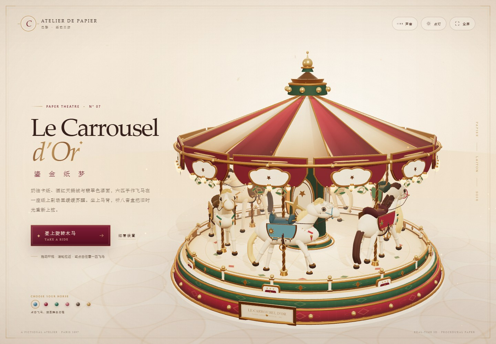

# 鎏金纸梦 · Le Carrousel d'Or

一座单独发布的复古奢华纸艺 3D 旋转木马。奶油卡纸、酒红天鹅绒、翡翠色漆面与黄铜鎏金，六匹手作飞马在一座纸上剧场里随程序化圆舞曲起落。



## 本地预览

从项目根目录启动独立静态服务：

```powershell
$env:PARK_ROOT = (Resolve-Path paper-carousel).Path
$env:PORT = '4180'
node scripts/server.mjs
```

打开 <http://127.0.0.1:4180/>。

## 交互

- 拖动画面环视，滚轮 / 双指缩放。
- 点击任意一匹飞马，或点击「登上旋转木马」，进入巡游镜头。
- 巡游中左右拖动，可转头环顾；`Esc` 或「结束体验」退出。
- 右上角打开 / 关闭实时合成的八音盒圆舞曲、点亮夜灯、进入全屏。
- 「细看装置」打开纸艺工坊的装置铭牌。

## 实现

- 本地 Three.js r180，无 CDN、无外部图片或音频。
- 全部模型、材质、贴图、环境与声音均在浏览器内程序化生成。
- 车顶 16 片条纹卡纸、12 幅扇贝形帷幔、48 盏暖灯、6 匹独立起伏的彩绘木马。
- 静态结构按材质合并，六匹木马各自独立合并；桌面 1440×1000 实测约 60 fps，162 draw calls / 27 万三角形。
- 支持日间 / 夜灯、桌面 / 移动端、`prefers-reduced-motion` 界面动效降级。

## 目录

```text
index.html        页面与界面结构
style.css         复古纸艺视觉、HUD 与响应式布局
main.js           镜头、指针交互、骑行、声音与界面控制
world.js          3D 场景、木马、材质、灯光与程序化贴图
audio.js          Web Audio 合成的八音盒圆舞曲
vendor/three/     本地 Three.js r180（MIT）
```

---

*一座虚构的纸上剧场。所有纸马，只为一场旧梦而存在。*
