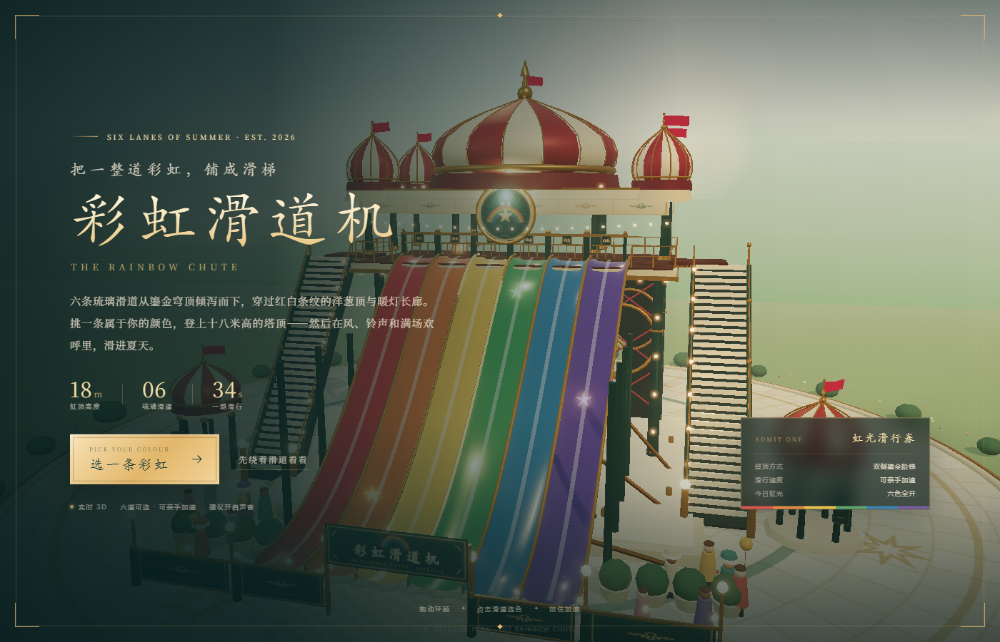
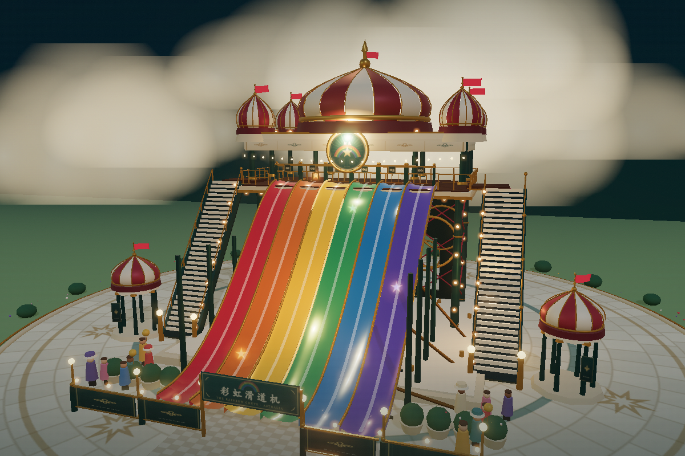

# 彩虹滑道机 · THE RAINBOW CHUTE

南庭的六道琉璃滑道。维多利亚式鎏金穹顶、红白条纹洋葱顶、双侧登顶阶梯、暖灯与六条可亲手选择的彩虹滑道。

**独立进入：** <http://127.0.0.1:4173/rainbow/>  
**从星梦奇境进入：** 在主乐园地图前往「彩虹滑道机」，按 `E` 打开联动体验。





## 怎么玩

- 点击任意滑道、底部的色点，或左右箭头，选择绯红 / 琥珀 / 鎏金 / 翡翠 / 湖蓝 / 紫晶；
- 点击「登上这道彩虹」，镜头会沿右侧鎏金楼梯登顶；
- 塔顶倒计时后自动出发；
- 滑行中按住 `W` / `↑` / 鼠标左键加速，`A D` 或 `← →` 微调左右，收集 14 枚虹光星屑；
- 到达终点会显示滑行时间、最高时速、星屑数量与称号；
- `Esc` 随时结束，回到滑道前重新选色。

## 界面工具

- 右上角：声音、天光（暮色 / 晴日 / 夜幕）、回到全景、帮助、全屏；
- 桌面端拖动画面环顾、滚轮拉近；
- 移动端支持触摸拖动和点击加速。

## 技术说明

- Three.js r180，本地 `vendor/three`，无 CDN、无外部贴图或音频；
- 滑道为程序化曲面网格 + `MeshPhysicalMaterial` 清漆材质，六条独立曲线；
- 穹顶为分段 LatheGeometry 条纹洋葱顶，附鎏金肋、旗杆与飘动旗帜；
- 灯泡使用 InstancedMesh + Points 光晕，Bloom 后期；
- 乘坐镜头使用阶梯样条、滑道样条与实时法线，支持加速、侧移与星屑碰撞；
- 音频为 Web Audio 实时合成：游乐场圆舞曲、玻璃铃、风声、欢呼与落水声；
- `?mood=night|dusk|day` 可指定初始天光，供主乐园 iframe 联动。

## 文件

```
index.html      UI 与 import map
style.css       整套界面、HUD、结果卡片与响应式布局
world.js        场景、塔楼、穹顶、六条滑道、灯光、星屑、环境
main.js         相机、选道、乘坐流程、交互与 UI 逻辑
audio.js        Web Audio 合成声景
```
