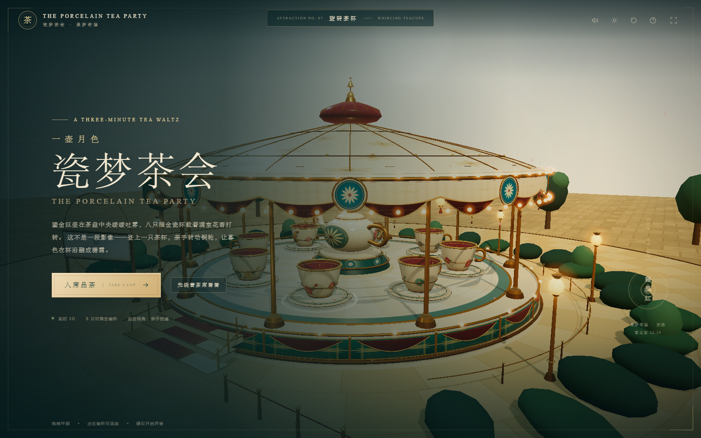

# 瓷梦茶会 · THE PORCELAIN TEA PARTY

一座可以走进去、亲手转动、乘坐的实时 3D 旋转茶杯。参考图中的奶油瓷、孔雀蓝、胭脂红与鎏金被重新建模为一座 **八角茶席**：中央是带青花团花的鎏金巨壶，八只描金瓷杯围着茶盘旋转，檐下 200 余盏灯与花瓣、蒸汽一起实时运动。

**独立入口：** <http://127.0.0.1:4173/teacup/>

在星梦奇境东庭也可以直接体验：走到「瓷梦茶会」前，按 `E` / 点击「进入茶杯 · 亲手操控」，乐园会直接把镜头放进杯内，使用同一个 3D 模型，不需要跳转页面。



[乐园中的外观](../preview/teacup-park.png) · [乐园杯内操控](../preview/teacup-park-ride.png) · [自由视角](../preview/teacup-explore.png) · [杯内视角](../preview/teacup-ride.png) · [夜幕](../preview/teacup-night.png) · [移动端](../preview/teacup-mobile.png)

## 可以怎么玩

- **自由环顾**：拖动旋转视角、滚轮缩放；点击任意茶杯直接选座。
- **登杯乘坐**：按 `E` / `Enter`，或点击「登上这只茶杯」，进入杯内第一人称视角。
- **亲手控速**：按住 `←` `→`（或 `A` `D`），也可以按住画面左右拖动，或使用屏幕上的左右铜轮按钮。杯速、离心倾斜和镜头侧倾都会实时响应。
- **八只不同的杯子**：釉里红、豆青、霁红、描金、青花、粉彩、金地、墨彩，每只都有独立纹样。
- **黄昏与夜幕**：右上角切换。入夜后，檐下灯串、桌面灯与星空会逐渐亮起。
- **环境声音**：实时合成的 3/4 拍八音盒茶会圆舞曲、杯碟轻响与旋转风声；右上角可以静音。
- **离席**：`Esc` 或右上角「离席」回到自由视角。

## 操作一览

| 操作 | 桌面 | 触屏 |
| --- | --- | --- |
| 环顾 / 选杯 | 拖动、滚轮、点击杯 | 拖动、点击杯 |
| 选上一 / 下一只杯 | `Q` / `Z`，或箭头按钮 | 左右箭头按钮 |
| 登杯 / 离席 | `E`、`Enter` / `Esc` | 「登上这只茶杯」/「离席」 |
| 转动茶杯 | 按住 `←` `→` 或 `A` `D`，左右拖动 | 按住画面拖动，或「向左 / 向右」 |
| 静音 | `M` | 右上角声音按钮 |
| 全屏 | `F` | 右上角全屏按钮（窄屏隐藏） |
| 游园指引 | `H` | 右上角问号 |

## 技术说明

- 纯原生 ES Modules + Three.js r180，本地 vendor，无构建步骤、无 CDN、无外部图片或音频。
- 所有模型、瓷器纹样、地面彩绘、檐下彩绘、灯串与蒸汽均在运行时程序化生成。
- 使用 `MeshPhysicalMaterial` 的清漆层模拟釉面，PMREM 程序化环境贴图提供金色反射。
- 八只杯子各有独立旋转轴与离心倾斜；整个茶盘绕中轴旋转。
- 自定义轨道相机、射线选杯、乘坐 POV、拖拽控速与键盘控制。
- 后期链路：RenderPass → UnrealBloom → OutputPass → 自定义瓷器调色（饱和度 / 对比 / 暗角）。
- 响应式 UI 与触屏适配；窄屏自动切换为单列茶帖。

## 目录

```
teacup/
  index.html          入口、茶帖 / 乘坐 HUD
  style.css           主视觉与响应式布局
  hud-overrides.css   乘坐 HUD 可读性与瓷器转场
  ride.js             旋转茶杯、茶壶、灯串、环境与实时动画
  main.js             相机、选杯、交互、昼夜与后期
  audio.js            Web Audio 八音盒圆舞曲与旋转声
```

---

*星梦奇境 · 东庭茶席。茶一直温着。*
